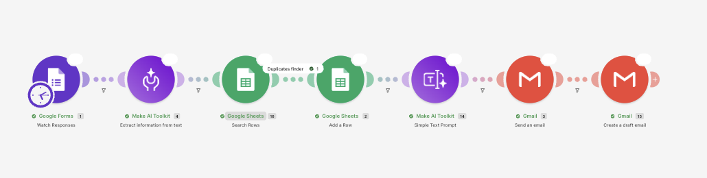

# AI Lead Management Automation

### Overview

An AI-assisted lead management workflow built in Make.com for a fictional landscaping business.

The system automates the processing of customer inquiries, extracts relevant service requirements, organizes lead information, and prepares personalized email responses for human review.

## Workflow Diagram

### Business Problem

Small service businesses often process customer inquiries manually. This involves reading messages, identifying project requirements, recording customer information, and drafting responses.

These repetitive administrative tasks can delay follow-ups and create opportunities for data-entry errors.

### Solution

This automation connects Google Forms, Make's AI Toolkit, Google Sheets, and Gmail to streamline lead intake.

When a prospective customer submits an inquiry, the workflow:

1. Retrieves the Google Forms submission.
2. Uses AI to extract service type, frequency, property size, and requested start date.
3. Checks the submission's Response ID against existing records.
4. Stores the inquiry and extracted information in Google Sheets when processing continues.
5. Generates a personalized email response.
6. Emails the business owner a notification containing the inquiry and proposed reply.
7. Creates a Gmail draft addressed to the customer for review.

Customer-facing responses are **not automatically sent**.

### Technology Stack

- **Make.com:** Workflow orchestration and integration
- **Google Forms:** Customer inquiry collection
- **Make AI Toolkit:** Structured information extraction and email generation
- **Google Sheets:** Lead storage and lookup
- **Gmail:** Owner notifications and customer reply drafts

### Design Decisions

**Structured extraction:** The AI extracts four predefined fields from free-form project descriptions.

**Response ID lookup:** A Google Sheets search is used to check for previously recorded submissions. Duplicate-handling behavior was tested in the demonstration environment.

**Human review:** AI-generated customer responses are saved as drafts rather than sent automatically.

**Grounded responses:** The generation prompt explicitly prohibits inventing prices, availability, appointments, or company policies.

### Limitations

This is a portfolio demonstration, not a production-hardened customer management system.

The workflow uses Google Sheets rather than a transactional database. Comprehensive handling of simultaneous submissions, downstream failures, and automatic recovery has not been established.

AI-generated content should be reviewed before sending.

### Setup Requirements

Recreating the workflow requires a Make account, Google Forms, Google Sheets, Gmail connections, and access to Make's AI Toolkit.

The appropriate Google accounts and destination spreadsheet must be connected and configured. The original scenario blueprint is retained privately; any publicly shared export must be reviewed and sanitized.

### Project Status

Functional demonstration completed with test inquiries. Technical documentation and portfolio demonstration are being finalized.
